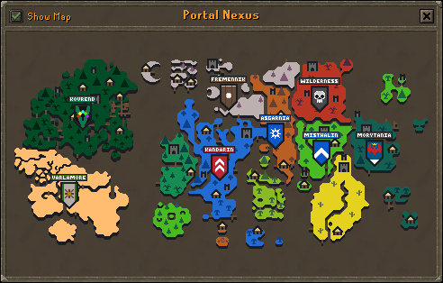
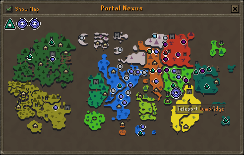

# Nexus Map Plugin
Completely changes the experience of the Player Owned House Nexus portal menu. 

Instead of scrolling through a list to find your destination, you're presented with an
interactive map of the game world.

Shortcut keys still work as usual.

You can also toggle a setting to display all teleports as small orbs on the overworld screen instead, speeding up navigation.

